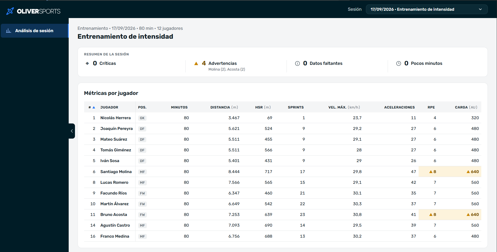
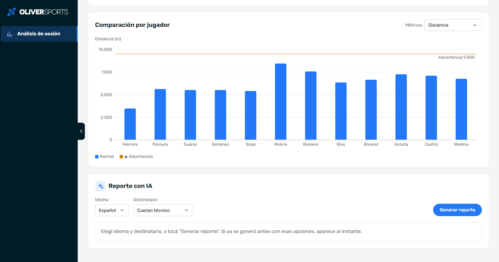

# ⚽ OLIVER — Mini reporte de sesión con IA

Dashboard de análisis de rendimiento deportivo para que un cuerpo técnico pueda revisar una sesión de entrenamiento o partido: consultar métricas individuales, identificar alertas de carga y generar un reporte con IA.

El proyecto está desarrollado a partir del challenge técnico de OLIVER. La solución cubre el flujo completo: carga de datos, API, visualización y generación de reportes, con especial atención a los datos incompletos y a evitar información inventada por el modelo.

## ✨ Funcionalidades

- Selector de sesión.
- Tabla de métricas por jugador, con ordenamiento por columna.
- Gráfico de métricas seleccionables por jugador.
- Alertas visuales según los umbrales del equipo.
- Reportes con IA en español o inglés: un informe colectivo para el cuerpo técnico o un informe individual para un jugador.
- Estados de carga, error y ausencia de datos en la interfaz.
- Caché de reportes para evitar llamadas repetidas al modelo.

## 🧰 Stack tecnológico

| Área | Tecnologías |
|---|---|
| Backend | Node.js, Express 5, SQLite (`better-sqlite3`), SQL directo |
| Validación | Zod |
| Frontend | React, Vite, Recharts |
| IA | Gemini 3.1 Flash-Lite (`@google/genai`) |
| Tests | Vitest |

---

## 🚀 Cómo ejecutar el proyecto

### Requisitos

- Node.js 22 o superior (probado con Node 24).
- Una API key de Gemini: [Google AI Studio](https://aistudio.google.com/apikey).

La aplicación necesita dos procesos ejecutándose al mismo tiempo: el backend y el frontend, cada uno en una terminal diferente.

### 1. Clonar el repositorio

```bash
git clone https://github.com/mschmidt17/OLIVER-Sports.git
cd OLIVER-Sports
```

### 2. Instalar y ejecutar el backend

En la primera terminal:

```bash
cd backend
npm install
cp .env.example .env
```

En Windows CMD, el comando para copiar el archivo es:

```cmd
copy .env.example .env
```

Abrí `backend/.env` y configurá `GEMINI_API_KEY` con tu clave de Gemini. Después ejecutá:

```bash
npm run seed
npm run dev
```

La API queda disponible en `http://localhost:4000`.

**Importante:** el seed debe ejecutarse antes del primer arranque. Crea las tablas y carga los datos de `session_data.json`; cada ejecución recarga todo desde cero, incluida la caché de reportes.

Sin `GEMINI_API_KEY` la tabla y el gráfico funcionan igual, pero el reporte devuelve un error `503` con un mensaje explicativo.

### 3. Instalar y ejecutar el frontend

En una segunda terminal, desde la raíz del proyecto:

```bash
cd frontend
npm install
npm run dev
```

Abrí la URL que muestra Vite (por defecto, `http://localhost:5173`). Vite redirige las llamadas a `/api/...` al backend, usando el `PORT` de `backend/.env`. Si aparece **“No se pudo conectar con el backend”**, verificá que el backend siga corriendo.

### 4. Ejecutar los tests

Desde la carpeta `backend`:

```bash
npm test
```

Cubren la detección de alertas, el armado del contexto, la validación de la respuesta del modelo, el manejo de errores del proveedor, el servicio de reportes con su caché y el contrato HTTP de las rutas: `GET /sessions`, el filtro y el orden de `GET /sessions/:id/metrics` (cada columna ordenable en las dos direcciones, valores sin dato al final, parámetros inválidos) y la validación del body de `POST /sessions/:id/report`. Gemini está simulado (no hace falta API key) y los tests que usan la base crean una SQLite temporal, sin tocar `data/oliver.db`.

### Variables de entorno

Configuración en `backend/.env`:

| Variable | Valor por defecto | Descripción |
|---|---|---|
| `PORT` | `4000` | Puerto de la API. También se utiliza para configurar el proxy del frontend. |
| `DB_PATH` | `data/oliver.db` | Ubicación de SQLite, relativa a `backend/`. |
| `AI_PROVIDER` | `gemini` | Proveedor de IA. |
| `GEMINI_API_KEY` | — | API key de Gemini. No debe subirse al repositorio. |
| `GEMINI_MODEL` | `gemini-3.1-flash-lite` | Modelo utilizado. |
| `AI_TIMEOUT_MS` | `20000` | Tiempo máximo de espera del modelo, en milisegundos. |

---

## 🔌 API

| Método | Ruta | Descripción |
|---|---|---|
| `GET` | `/sessions` | Lista las sesiones (id, fecha, título y tipo). |
| `GET` | `/sessions/:id/metrics` | Devuelve las métricas de los jugadores (también por minuto jugado), los umbrales y las alertas calculadas. |
| `POST` | `/sessions/:id/report` | Genera el reporte con IA o devuelve uno válido desde la caché. |

### Filtrar y ordenar métricas

```http
GET /sessions/103/metrics?player_id=5
GET /sessions/103/metrics?order_by=total_distance_m&order=desc
```

`order_by` se valida contra una lista de columnas permitidas, porque `ORDER BY` no acepta parámetros SQL y la columna se interpola en la consulta. Los `null` quedan siempre al final.

### Generar un reporte

Informe colectivo para el cuerpo técnico:

```bash
curl -X POST http://localhost:4000/sessions/103/report \
  -H "Content-Type: application/json" \
  -d '{ "language": "es", "audience": "coach" }'
```

Informe individual para un jugador:

```bash
curl -X POST http://localhost:4000/sessions/103/report \
  -H "Content-Type: application/json" \
  -d '{ "language": "es", "audience": "player", "player_id": 5 }'
```

| Campo | Valores | Por defecto | Descripción |
|---|---|---|---|
| `language` | `es`, `en` | `es` | Idioma del reporte. |
| `audience` | `coach`, `player` | `coach` | `coach`: informe colectivo. `player`: informe individual (ver [Dos tipos de informe](#dos-tipos-de-informe)). |
| `player_id` | entero positivo | — | Obligatorio con `audience: "player"`; no se acepta con `coach` (400). |
| `refresh` | `true`, `false` | `false` | Con `true`, ignora la caché y genera un reporte nuevo. |

La respuesta incluye siempre `language`, `audience`, `prompt_version`, `model`, `cached` y `created_at`. El resto depende del tipo:

- **coach:** `summary`, `highlights` (2 o 3 jugadores con su motivo), `alerts` (por jugador, con sus niveles y un comentario) y `missing_data`.
- **player:** `player` (identidad, minutos y métricas desde la base), `summary`, `positives` (1 a 3, cada uno con la métrica en la que se apoya), `improvements` (0 a 2), `alerts` (las del jugador), `alert_comment` (`null` si no tiene alertas) y `missing_data`.

---

## 🏗️ Arquitectura

```text
Frontend (React + Vite)
        |
        | /api/...
        v
Vite proxy (desarrollo)
        |
        v
Backend (Express)
        |
        +------ SQLite
        |         |
        |         +-- sesiones, jugadores y métricas
        |         +-- caché de reportes
        |
        +------ Lógica de dominio
        |         |
        |         +-- detección de alertas
        |         +-- armado del contexto
        |         +-- validación del reporte
        |
        +------ Proveedor de IA
                  |
                  v
              Gemini
```

La lógica de negocio se mantiene separada de las rutas y de la integración con el proveedor de IA. Las rutas validan la entrada y delegan el trabajo en los servicios; las reglas de alertas y validación viven en módulos de dominio independientes.

## 📁 Estructura del proyecto

```text
backend/
├── session_data.json
└── src/
    ├── server.js
    ├── db/
    │   ├── schema.sql
    │   ├── connection.js
    │   └── seed.js
    ├── routes/
    │   └── sessions.routes.js
    ├── services/
    │   ├── metrics.service.js
    │   └── report.service.js
    ├── domain/
    │   ├── alerts.js
    │   ├── buildContext.js
    │   └── validateReport.js
    ├── ai/
    │   ├── index.js
    │   └── geminiClient.js
    └── prompts/
        ├── sessionReport.v4.js   (informe colectivo)
        └── playerReport.v1.js    (informe individual)

frontend/
├── public/
└── src/
    ├── App.jsx
    ├── metrics.js
    ├── api/
    │   └── client.js
    └── components/
        ├── Sidebar.jsx
        ├── SessionSelector.jsx
        ├── SessionHeader.jsx
        ├── MetricsTable.jsx
        ├── MetricChart.jsx
        ├── ReportPanel.jsx
        └── icons.jsx
```

---

## 🤖 Integración con IA

### Dos tipos de informe

El challenge pide que el endpoint acepte `audience` (`coach` | `player`), pero no define qué cambia para cada uno. Al principio `player` solo cambiaba el tono del informe del equipo, que además mostraba a todo el plantel las alertas de cada compañero. Decidí interpretarlo como un **informe individual**, que es lo que le sirve a un jugador:

| | `coach` | `player` |
|---|---|---|
| Lector | Cuerpo técnico | Un jugador (`player_id`) |
| Datos que recibe la IA | Todos los jugadores de la sesión | Solo los del jugador elegido |
| Contenido | Resumen del equipo, 2–3 destacados, alertas con acciones sugeridas | Resumen de su sesión, 1–3 puntos positivos, 0–2 aspectos a mejorar, alertas con una recomendación prudente |
| Tono | Técnico | Segunda persona, sin jerga |
| Prompt | `sessionReport.v4.js` | `playerReport.v1.js` |

Se mantiene un único endpoint porque el challenge pide `audience` en él; el servicio separa los dos flujos. Una ruta propia (`POST /sessions/:id/players/:playerId/report`) dejaba a `audience: "player"` sin un significado claro.

El informe individual no puede comparar al jugador con sus compañeros porque el modelo no recibe sus datos. Los aspectos a mejorar son opcionales: sin historial ni objetivos individuales, a veces no hay con qué fundamentarlos.

### Modelo elegido: Gemini 3.1 Flash-Lite

Elegí Gemini porque permite pedir respuestas estructuradas con JSON Schema en su tier gratuito, y en las pruebas `gemini-3.1-flash-lite` fue rápido y estable. El modelo solo redacta: no calcula métricas ni decide alertas. Uso temperatura `0.3` para priorizar respuestas consistentes, y el modelo se cambia con `GEMINI_MODEL`.

### Contexto que recibe el modelo

Antes de llamar a Gemini, el backend prepara la información necesaria en `domain/buildContext.js`:

- Alertas detectadas previamente, con su nivel y umbral.
- Métricas por minuto (distancia, carrera a alta velocidad, sprints y aceleraciones), para dar contexto cuando los jugadores participaron distinta cantidad de tiempo.
- Indicador `low_minutes` para quienes jugaron menos del 50% de la sesión.
- Datos faltantes identificados explícitamente, para que un `null` no se interprete como cero.
- Identificación de jugadores mediante `player_id`, sin enviar sus nombres al modelo.

El informe individual usa la misma función con las métricas ya filtradas por `player_id`: el contexto solo tiene a ese jugador, sus alertas y sus datos faltantes.

### Cómo se evita mostrar datos inventados

Pedir un JSON con esquema no alcanza: la respuesta se valida después de recibirla.

1. **Estructura:** el esquema se define una vez en Zod, se convierte a JSON Schema para Gemini y se usa de nuevo para validar la respuesta.
2. **Jugadores:** se descartan los `player_id` que no están en la sesión y los comentarios de alerta de jugadores sin alerta calculada. Si quedan menos de dos destacados, se rechaza la respuesta.
3. **Números:** cada número de los textos tiene que existir en los datos que recibió el modelo; si no, se rechaza. El motivo de un destacado y el comentario de una alerta solo pueden citar números de **ese** jugador o de la sesión (duración, fecha, umbrales): así no se le atribuye a un jugador el dato de otro. El `player_id` no cuenta como dato. En el informe individual el contexto solo tiene al jugador, así que un número de un compañero también se rechaza.
4. **Datos de la base:** nombres, métricas y alertas se completan desde la base. Si el modelo omite una alerta, igual aparece en el reporte. Un destacado con alertas muestra su nivel (crítico o advertencia) junto al nombre, aunque el motivo escrito por el modelo no lo mencione.
5. **Positivos sobre métricas con alerta (individual):** cada positivo declara la métrica en la que se apoya, y si esa métrica tiene alerta se descarta: superar un umbral es algo a cuidar, no un logro. Si no queda ninguno, se rechaza. Lo agregué porque en las pruebas el modelo felicitó a un jugador por una distancia con alerta aunque el prompt lo prohibía.

**Límites:** el control de números es estricto (un porcentaje bien calculado pero ausente de los datos provoca un rechazo), no detecta números escritos en palabras ("doce"; el prompt pide dígitos, pero no se verifica) y no puede saber de qué métrica habla un número que coincide con otra del mismo jugador. Tampoco se pueden verificar afirmaciones cualitativas como “la mayor distancia del equipo”, ni que un positivo hable de la métrica que declara. Por eso los niveles de alerta que se muestran siempre salen del backend, no del texto generado.

### Prompts versionados

Hay un prompt por tipo de informe en `backend/src/prompts/`, cada uno con su versión (`PROMPT_VERSION`) y su esquema: `sessionReport.v4.js` y `playerReport.v1.js`. En el repo quedan solo los prompts en uso; las versiones anteriores están en el historial de git:

- **v1:** una frase de tono por destinatario; los reportes casi no se diferenciaban.
- **v2:** instrucciones concretas por destinatario, pero `player` seguía siendo un informe colectivo.
- **v3 + playerReport.v1:** el colectivo conserva las instrucciones de v2 para el cuerpo técnico y el del jugador pasa a ser individual.
- **v4:** un destacado con alertas puede seguir siendo destacado (a veces lo es justamente por su carga), pero el motivo tiene que decir que requiere atención. Los números se piden con dígitos, porque la validación no reconoce números escritos en palabras.

Cada reporte informa con qué prompt y modelo se generó (tooltip sobre la fecha de generación).

### Manejo de errores

- **Timeout:** se controla con `AbortController`; devuelve `504`.
- **Reintentos:** se realiza un reintento ante errores temporales `429` (rate limit) y `503` (modelo saturado).
- **Respuesta inválida o error del proveedor:** devuelve `502`.
- **Proveedor no disponible:** si falta la API key o el proveedor continúa saturado después del reintento, devuelve `503`.

El proveedor se elige con `AI_PROVIDER`. Timeout, reintentos y mapeo de errores son comunes; sumar otro proveedor es implementar un cliente con la misma interfaz.

---

## ⚖️ Decisiones de diseño y trade-offs

### Datos incompletos

- Se conservan los IDs originales del JSON.
- Los valores faltantes (`rpe` y `workload_au` en `null`) se muestran como **sin dato**, nunca como `0`.
- El seed recrea las tablas y vuelve a cargar los datos desde el JSON. Es simple y reproducible para el challenge, pero en un sistema real lo reemplazaría por migraciones.

### Alertas calculadas en el backend

Las alertas se calculan en `domain/alerts.js`, no en el modelo, y son la única fuente para la tabla, el gráfico y el reporte.

El enunciado habla de superar el umbral; decidí alertar cuando el valor **alcanza o supera** el umbral (`>=`), porque en carga física es más prudente avisar también al llegar al límite (un RPE de 8 con umbral 8 alerta). Un valor crítico se muestra solo como crítico, sin duplicarse como warning.

### Caché de reportes (bonus)

La caché evita volver a llamar al modelo con los mismos parámetros (milisegundos en lugar de segundos).

- **Clave:** sesión + jugador + idioma + destinatario + versión del prompt + modelo. Si cambia el prompt o el modelo, no se reutilizan reportes viejos.
- **Informe colectivo:** usa `player_id = 0`, no `NULL`: en SQLite dos `NULL` no son iguales dentro de una clave, así que `INSERT OR REPLACE` acumularía duplicados.
- **Contenido:** solo la respuesta cruda del modelo que ya pasó las validaciones. Se vuelve a validar en cada uso contra los datos actuales; si ya no pasa, se genera un reporte nuevo.
- **Regeneración:** `refresh: true` ignora la caché.

### Decisiones de frontend y experiencia de uso

- **Ordenamiento local:** con 12 filas, la tabla se ordena en el navegador y evita una request por clic. La API igual soporta `order_by`, como pide el challenge.
- **Métricas por minuto:** el reporte se apoya en valores por minuto para comparar jugadores con distintos minutos, así que el gráfico también los ofrece (grupo "Por minuto jugado" del selector), pero solo cuando hay jugadores con distintos minutos: si todos jugaron la sesión completa, como en los entrenamientos, el gráfico por minuto sería el de los totales con otra escala. La API los calcula con la misma función que arma el contexto de la IA, así el entrenador ve exactamente los mismos números. No tienen umbral ni alertas, porque los umbrales del equipo se aplican a los totales. Los dejé en el gráfico y no en la tabla para no sumar cuatro columnas.
- **Proxy de Vite:** un único origen desde el navegador, sin configurar CORS.
- **Layout adaptable:** el reporte va al costado de los datos solo si la tabla entra completa; si no, debajo. Se resuelve con una container query, que responde al espacio disponible y no al tamaño de la ventana. Pensado para computadora.
- **Jerarquía visual:** la tabla y las métricas son el foco; las alertas se identifican con color, ícono y texto.
- **Reporte:** al elegir el destinatario "Jugador" aparece un selector de jugador y el botón se habilita al elegir uno. El formato, el idioma y "Regenerar" dependen del informe recibido, no de los selectores, que pueden haber cambiado después.

---

## 🔭 Qué mejoraría con más tiempo

### Mejoras funcionales

- **Chatbot para el cuerpo técnico:** incorporar un asistente conversacional que permita consultar aspectos puntuales de las sesiones, jugadores y métricas, utilizando los datos disponibles como contexto y aplicando las mismas validaciones que el reporte para no inventar datos.
- **Recomendaciones más específicas:** ajustar los prompts para generar sugerencias más útiles según el rol de quien consulta. Por ejemplo, si un jugador presenta indicadores de carga elevados, ofrecer al preparador físico posibles aspectos a revisar o trabajar, siempre fundamentados en los datos y sujetos a su criterio profesional.
- **Exportación de métricas:** permitir descargar los datos de las sesiones en distintos formatos, como CSV, Excel y PDF, para facilitar su análisis y compartirlos con el cuerpo técnico.
- **Evolución del jugador:** hoy cada informe describe una única sesión, y la carga de una sola sesión no alcanza para evaluar cómo evoluciona un jugador. Un historial entre sesiones permitiría identificar tendencias y le daría al informe individual una referencia propia (el jugador contra sí mismo) para fundamentar los aspectos a mejorar.
- **Alertas según el contexto deportivo:** hoy los umbrales son los mismos para todo el equipo. Una misma carga no significa lo mismo en un partido que en un entrenamiento, ni para un arquero que para un mediocampista. Me gustaría poder definir umbrales por tipo de sesión y por posición, y que el reporte interprete cada alerta con ese contexto, sin dejar de calcularla en el backend.

### Mejoras técnicas

- Incorporar migraciones de base de datos en lugar de recrear las tablas con el seed.
- Incorporar tests del frontend para el ordenamiento, las alertas, los resúmenes y los estados del reporte.
- Evitar llamadas duplicadas al modelo cuando llegan solicitudes iguales en simultáneo.
- Mejorar la validación de las afirmaciones cualitativas generadas por la IA para reducir interpretaciones que no estén suficientemente respaldadas por los datos.

### Visualización

- Mostrar los valores faltantes directamente en los gráficos para que sea más fácil identificar cuándo no hay información disponible.

### Decisión sobre streaming

No implementé streaming con SSE porque prioricé validar el reporte completo antes de mostrarlo. De esta manera, el usuario recibe únicamente respuestas que hayan pasado las validaciones de estructura y consistencia con los datos disponibles.

---

## 🛠️ Uso de herramientas de IA durante el desarrollo

Utilicé **Claude Code** como asistente durante el desarrollo.

- Definí desde el inicio el stack, la estructura del proyecto, las reglas de código y las decisiones principales.
- Dividí el trabajo en fases: configuración, API, lógica de dominio, integración con IA, frontend, caché y documentación.
- Revisé el código generado, discutí las decisiones técnicas y no incorporé cambios automáticamente: evalué si simplificaban o agregaban complejidad innecesaria.
- Ejecuté tests, probé la integración con Gemini y verifiqué el dashboard en el navegador.
- Antes de entregar, cloné el repositorio en una carpeta limpia y seguí los pasos de este README para comprobar la instalación.

El archivo `CLAUDE.md` de la raíz conserva las reglas y decisiones del proyecto para mantener el contexto de trabajo con la herramienta.

---

## 📝 Convención de commits

Se utilizó una convención basada en [Conventional Commits](https://www.conventionalcommits.org/), con descripciones en español. Por ejemplo:

```text
feat(ui): estilo compacto de tabla y gráfico
fix: corregir validación de reporte
test: agregar casos de datos incompletos
docs: actualizar README
chore: reducir el alto del selector de sesión
```


---

## 📸 Capturas

Resumen de la sesión y tabla de métricas, con los valores que alcanzan un umbral resaltados:

<p align="center">
  
</p>

Gráfico por jugador con la línea del umbral y panel del reporte con IA:

<p align="center">
  
</p>
